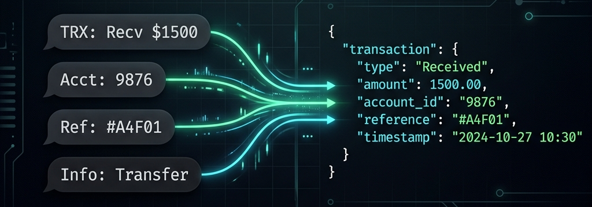

<p align="center">
  
</p>

# bd-trx-parser

> Parse transaction and balance SMS notifications from Bangladeshi banks and mobile financial services (MFS) into typed, structured Python objects. Zero external dependencies. Python 3.10+.

[](https://github.com/nadimtuhin/bd-trx-parser/actions/workflows/test.yml)
[](LICENSE)
[](pyproject.toml)

---

## Why this exists

In Bangladesh, there is no Plaid, no Teller, and no Open Banking API for retail accounts. If you want to track your personal finances in tools like Actual Budget, Firefly III, Lunch Money, or a synchronized Google Sheet, your only real-time source of truth is the SMS notification that buzzes your phone after every debit card swipe, ATM withdrawal, or bKash payment.

Parsing these SMS messages by hand is deceptively painful:

- **Format Drift**: A bank might use `Tk.` one week, switch to `BDT` the next, format accounts as `AC` or `A/C`, and append trailing dots (`BDT 5000.`) that crash standard `float()` parsers.
- **Credit Card Semantic Traps**: On credit cards, the SMS balance reported is almost always **available credit**, not your outstanding bill. An SMS saying `Bal Tk. 780,000` on an 800,000 limit means you owe 20,000, not 780,000.
- **Multi-Tranche Remittances**: International inward remittances to mobile wallets (like bKash) often arrive split across a main remittance credit SMS and a separate 2.5% Government Incentive SMS, neither of which includes a wallet balance line.
- **Idiosyncratic Syntax**: Between BEFTN, NPSB, POS purchases, ATM cash out, merchant QR scans, and monthly bill statements, every institution invents its own text grammar.

`bd-trx-parser` is the distilled, battle-tested parsing engine extracted from over 3 years of daily personal finance automation across 9+ Bangladeshi institutions. It handles these quirks gracefully, uses exact `Decimal` math for monetary precision, enforces strict type annotations, and requires **zero external runtime dependencies** (pure Python standard library).

---

## Quickstart

```python
from bd_trx_parser import parse_sms, parse_balance

# 1. Parse a Dutch-Bangla Bank ATM cash withdrawal
dbbl_sms = "Dear Customer, your A/C ***6949 debited (ATM Cash Withdrawal) by Tk20,000.00 on 12-Oct-26. C/B Tk39,792.32. NexusPay"
txn = parse_sms(dbbl_sms, sender="16216", date="2026-10-12")

print(txn)
# Transaction(
#     bank=<Bank.DBBL: 'DBBL'>,
#     account='***6949',
#     txn_type=<TxnType.DEBIT: 'DR'>,
#     amount=Decimal('20000.00'),
#     currency='BDT',
#     description='ATM Cash Withdrawal',
#     date=datetime.date(2026, 10, 12),
#     hash='...'
# )

bal = parse_balance(dbbl_sms, sender="16216")
print(bal.balance)  # Decimal('39792.32')
print(bal.is_liability)  # False (deposit account)

# 2. Parse a City Bank AMEX purchase and check credit card liability
amex_sms = "BDT 1,816.00 purchased at PIZZA BURG on 25-Oct-26. CARD NO: 376***010. Bal BDT 780,554.82."
amex_txn = parse_sms(amex_sms)
amex_bal = parse_balance(amex_sms)

print(amex_txn.amount)       # Decimal('1816.00')
print(amex_txn.description)  # 'PIZZA BURG'
print(amex_bal.is_liability) # True (credit card available credit)
```

---

## Installation

```bash
pip install bd-trx-parser
```

Or using `uv`:

```bash
uv add bd-trx-parser
```

---

## Supported Institutions

| Institution | Senders / Shortcodes | Transaction Types Supported | Balance Patterns Handled |
|---|---|---|---|
| **EBL** (Eastern Bank) | `EBL`, `16230` | Savings DR/CR, BEFTN, NPSB, Debit POS, Credit Card (BDT/USD) purchases, payments, reversals, ATM cash withdrawals | `Balance is BDT`, `Your A/C ... Balance BDT`, `Balance: BDT` (card liability) |
| **DBBL** (Dutch-Bangla Bank) | `16216`, `DBBL` | Savings DR/CR, ATM withdrawals, POS purchases | `C/B Tk ...` |
| **City Bank** | `CityBank`, `16234` | Savings DR/CR, CITYTOUCH transfers, DPS issuance | `Tk. ... Balance` |
| **City AMEX** | `CityBank`, `AMEX` | POS purchases, Card payments, reversals, international spend | `Bal Tk. ...`, `Bal BDT ...` (card liability) |
| **AIBL** (Al-Arafah Islami Bank) | `AIBL`, `16268` | Savings DR/CR, Umrah DPS debits, FDR transfers | `Balance: BDT ...` |
| **bKash** | `bKash`, `16247` | P2P Send Money, Received Money, Cash In, Cash Out, Merchant QR, Mobile Recharge, Inward Remittance + Govt Incentive, Bill Pay, Refunds, Cashback | `Balance Tk ...` |
| **Nagad** | `Nagad`, `16167` | Send Money, Money Received, Cash In, Cash Out, Merchant Payments | `Balance: Tk ...` |
| **Midland Bank** | `Midland`, `MDB` | Credit card purchases, bill statements | Monthly bill statements, `Balance is BDT ...` |
| **PathaoPay** | `PathaoPay` | Wallet payments, deposits, adjustments | `Balance BDT ...` |

> Messages that do not represent transactions (such as OTPs, 2FA codes, security warnings, or marketing text) are safely ignored and return `None`.

---

## Core API

### `parse_sms(text, sender=None, *, date=None, bank=None)`
Extracts a `Transaction` object from SMS text.
- `sender`: Optional SMS sender ID / shortcode (e.g. `"EBL"`, `"16216"`, `"bKash"`). When provided, restricts evaluation to that institution's parser.
- `date`: Optional transaction date (`datetime.date`, `datetime.datetime`, or ISO string `YYYY-MM-DD`). Used to populate the date field and generate the transaction hash.
- `bank`: Optional explicit `Bank` enum to force a specific parser.

### `parse_balance(text, sender=None, *, date=None, bank=None)`
Extracts an `AccountBalance` object from SMS text.
- For bank accounts and wallets, `balance` reflects current funds (`is_liability=False`).
- For credit cards, `balance` reflects remaining available credit (`is_liability=True`).

### `detect_bank(sender)`
Helper that resolves an SMS sender mask or shortcode into a typed `Bank` enum member.

---

## Data Models

All monetary figures use Python's standard `decimal.Decimal` to avoid floating-point rounding errors:

```python
class Transaction:
    bank: Bank                # e.g. Bank.EBL, Bank.BKASH
    account: str              # Masked account or card number (or "wallet")
    txn_type: TxnType         # TxnType.DEBIT or TxnType.CREDIT
    amount: Decimal           # Positive transaction amount
    currency: str             # "BDT", "USD", etc.
    description: str          # Merchant name, transfer type, or narration
    date: Optional[date]      # Transaction date if known
    reference: Optional[str]  # TrxID / Ref number if present in SMS
    hash: str                 # 16-character deduplication hash

class AccountBalance:
    bank: Bank                # Bank enum
    account: str              # Masked account or card number
    balance: Decimal          # Balance amount
    currency: str             # "BDT", "USD", etc.
    date: Optional[date]      # As of date if known
    is_liability: bool        # True for credit cards (available credit)
```

---

## Deduplication Strategy

Each parsed transaction computes a deterministic SHA-256 fingerprint:

$$\text{hash} = \text{sha256}(\text{date} \mid \text{bank} \mid \text{amount} \mid \text{txn\_type})[:16]$$

This allows matching identical transactions when both an SMS alert and an email bank statement arrive for the same purchase, preventing double-counting in automated pipelines.

---

## CLI Usage

You can parse messages directly from your terminal or shell pipeline:

```bash
# Direct argument
bd-trx-parser --sender bKash "Payment Tk 300.00 to SHOPNO successful. Balance Tk 1,234.56. TrxID AB12CD34EF"

# Or pipe via stdin
echo "Cash WD BDT5000 from EBL ATM. Card 452017**9006. Your A/C 127**9952 Balance BDT 17984.3." | python -m bd_trx_parser
```

Outputs formatted JSON:

```json
{
  "transaction": {
    "bank": "EBL",
    "txn_type": "DR",
    "amount": "5000.00",
    "currency": "BDT",
    "account": "127**9952",
    "description": "ATM Cash WD (ATM)",
    "date": null,
    "reference": null,
    "hash": "..."
  },
  "balance": {
    "bank": "EBL",
    "account": "127**9952",
    "balance": "17984.30",
    "currency": "BDT",
    "date": null,
    "is_liability": false
  }
}
```

---

## Contributing

Pull requests are welcome! If your bank recently changed its SMS layout or you want to add support for a new financial institution (e.g. BRAC Bank, Islami Bank Bangladesh, Upay):

1. Fork and clone the repository.
2. Install development dependencies:
   ```bash
   uv venv && uv pip install -e ".[dev]"
   ```
3. Add sanitized SMS fixtures to `tests/fixtures/sms.py` (ensure **all** account numbers, phone numbers, and names are masked).
4. Run tests and type checking:
   ```bash
   pytest
   ruff check .
   mypy src
   ```

---

## License

[MIT](LICENSE) © [Nadim Tuhin](https://github.com/nadimtuhin)
